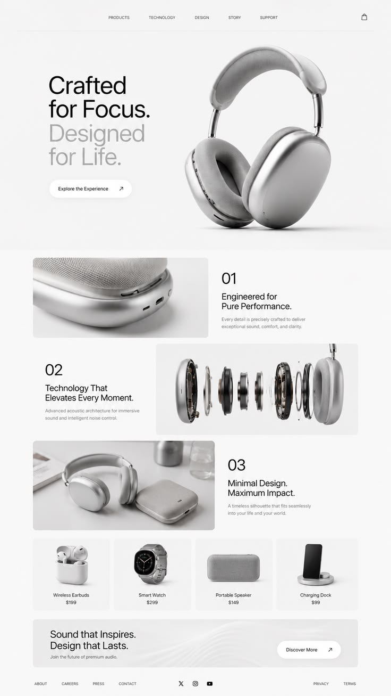

# Materi: HTML & CSS

Membuat landing page dengan inspirasi yang didapat dari pinterest dan menambahkan WhatsApp logo di kanan bawah dengan memanfaatkan atribut posistion.

## Inspirasi

[Link to Pinterest](https://id.pinterest.com/pin/1132936850041974499/)

## Screenshot Clone Landing Page

[Link to Code](index.html)

